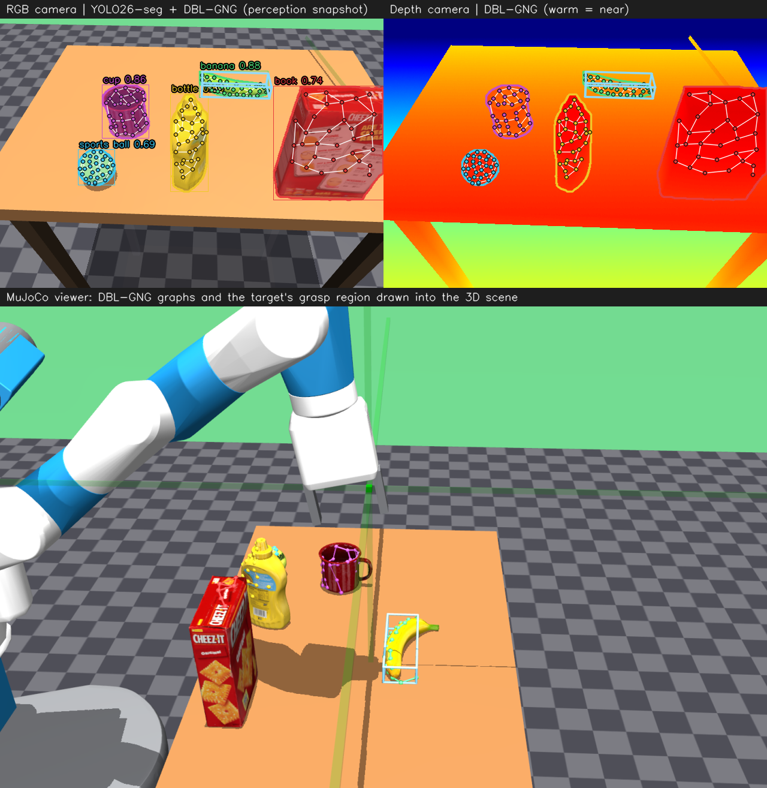
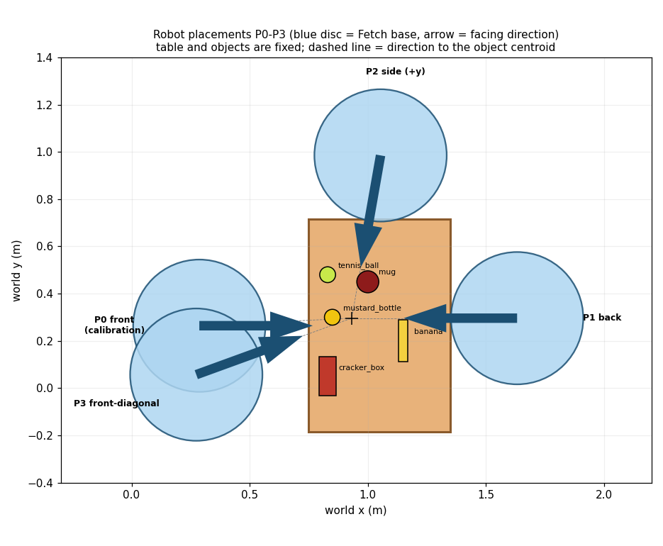

# Geometric Grasp Affordance

Code, data and logs for the paper **"Geometric Grasp Affordance: Estimating Gripper-Compatible Grasp Regions from Instance Segmentation and
Distributed Batch Learning Growing Neural Gas"**.

A simulated Fetch robot segments tabletop objects with **YOLO26s-seg**, back-projects each mask into world-frame points, summarises the visible
surface with a **Distributed Batch Learning Growing Neural Gas (DBL-GNG)** graph, and derives a gripper-compatible grasp region (closing width,
top-down / side-entry feasibility, finger-reach-limited region) from the graph nodes and the parallel-jaw gripper dimensions. Class labels are not used.
"Affordance" here means *geometric feasibility relative to the gripper*, not a learned affordance score.



*The live demo: annotated RGB camera (YOLO26 masks + DBL-GNG graphs + grasp region), depth camera with the graphs, and the MuJoCo scene with the graphs drawn in 3D.*

## Video

The demonstration video linked in the paper: **[Pick and Place using Instance Segmentation and DBL-GNG](https://www.youtube.com/watch?v=F42-p75Sw6M)** (YouTube).

[](https://www.youtube.com/watch?v=F42-p75Sw6M)

## Try it in five commands

```bash
sudo apt update && sudo apt install -y git python3.10 python3.10-venv libegl1 libgl1 ffmpeg
git clone https://github.com/yani-rl-ai/geometric-grasp-affordance.git && cd geometric-grasp-affordance
python3 -m venv .venv && source .venv/bin/activate && pip install --upgrade pip && pip install -r requirements.txt
python check_setup.py        # installation self-test
python run_live_demo.py      # robot + RGB camera + depth camera + DBL-GNG graphs on screen
```

Full instructions, options, troubleshooting and how to reproduce every table of the paper: **[docs/TUTORIAL.md](docs/TUTORIAL.md)**.

## What was evaluated

Five YCB objects (cracker box, mustard bottle, mug, banana, tennis ball) at fixed poses, four robot placements (P0-P3, see below), five trials per object and
placement, with base-pose jitter (+-15 mm, +-2 deg), Gaussian depth noise (1.5 mm) and logged seeds; two independent seeds (200 trials).
A grasp counts as successful only if the object is lifted >= 5 cm, still >= 5 cm after a 2.0 s hold, and the fingers still touch it.
The width bias, grasp depth and finger gain were calibrated at P0 only and frozen before the other placements were run.

| Result (both seeds pooled, 200 trials) | |
|---|---|
| Target detected and segmented | 195/200 (97.5%; Wilson 95% CI 94-99%); all 5 misses are the cracker box |
| Sustained lift-and-contact criterion | 167/200 (83.5%; CI 78-88%); seed 1: 81/100, seed 2: 86/100 |
| By object | cracker box 34/40, mustard bottle 40/40, mug 40/40, tennis ball 40/40, **banana 13/40** |
| By placement | P0 46/50, P1 42/50, P2 37/50, P3 42/50 |
| Mean region-centre error (detected targets) | 13.8 mm (95th percentile 32.0 mm) |
| Latency per stage (150-trial profiling run) | render 2.76 ms, YOLO26s-seg (GPU) 10.94 ms, DBL-GNG (CPU, per object instance) 5.05 ms, planner 0.09 ms |

These are observations in this simulated configuration, not estimates of general grasp success. Limitations stated in the paper: five objects at fixed poses,
one gripper, placements limited by the COCO detector (it rarely segments the cracker box from other sides, and no placement on the -y side qualified),
only top-down entry was ever selected (side entry is untested), the banana fails because its grasp slips within the 2 s hold, the estimated closing
widths are conservative (smaller than the true widths), and the width bias was calibrated on the evaluation objects. Exploratory component results (graph vs.
raw points; a no-bias setting chosen post hoc) are in the paper and in `results/results_tables.md`.



## Repository

| Path | Content |
|---|---|
| `run_live_demo.py` | live demo with RGB, depth and DBL-GNG windows |
| `run_pose_eval.py`, `scripts/reproduce_paper.sh` | the paper's evaluation protocol and all experiment steps |
| `dbl_gng_paper.py` | DBL-GNG of Siow et al. (2024), Algorithms 1-6, NumPy / CPU |
| `grasp_planner.py`, `perception.py`, `sim_core.py`, `yolo_segmenter.py`, `gng_overlay.py`, `viz.py` | planner, perception, simulation, detector, helpers |
| `dbl_gng.py` | the earlier batch GNG with edge aging, kept only as ablation baseline |
| `check_setup.py` | installation self-test |
| `analyze_pose_eval.py`, `analyze_perception_metrics.py`, `make_results_tables.py`, `print_table1_params.py` | regenerate the paper's tables and numbers |
| `results/paper_runs/` | per-trial logs and run configurations of every run reported in the paper |
| `results/results_tables.md` | tables generated from those logs |
| `scene.xml`, `assets/` | MuJoCo scene, Fetch model, YCB objects ([docs/ASSETS.md](docs/ASSETS.md)) |

Not included: the video files (the demonstration video is on [YouTube](https://www.youtube.com/watch?v=F42-p75Sw6M); `run_live_demo.py --record` and
`run_pose_eval.py` record new ones) and the YOLO26 weights (downloaded automatically on first use).

## Citation

The paper is not published yet; please update this block when it is.

```bibtex
@unpublished{geometric_grasp_affordance,
  title  = {Geometric Grasp Affordance: Estimating Gripper-Compatible Grasp Regions from Instance Segmentation
            and Distributed Batch Learning Growing Neural Gas},
  author = {Al Ais, Ikmal and Yani, Mohamad and Djalil, Agung Firmansyah and Riansyah, Moch Iskandar and
            Widyantara, Helmy and Kubota, Naoyuki},
  note   = {Manuscript}
}
```

The graph learning follows C. Z. Siow, A. A. Saputra, T. Obo and N. Kubota, "Distributed batch learning of growing neural gas for quick and efficient
clustering", *Mathematics* 12(12), 1909, 2024. Please cite it as well.

## License

The code and result logs of this repository are released under the [MIT License](LICENSE). Third-party components have their own terms: the YOLO26 weights
and the `ultralytics` package (AGPL-3.0 as published by Ultralytics - check their current terms), MuJoCo (Apache-2.0), and the scene assets listed in
[docs/ASSETS.md](docs/ASSETS.md), whose redistribution terms the authors have not independently verified.
